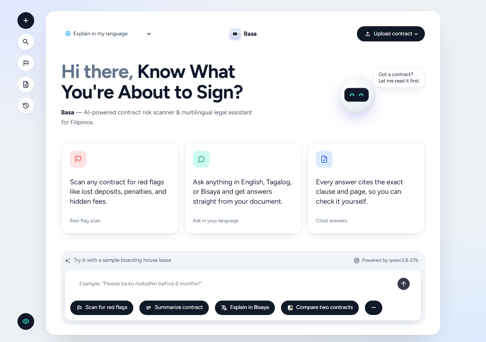
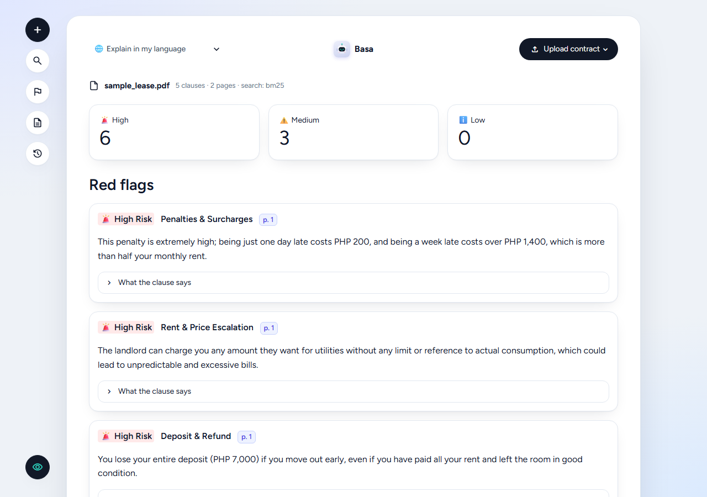
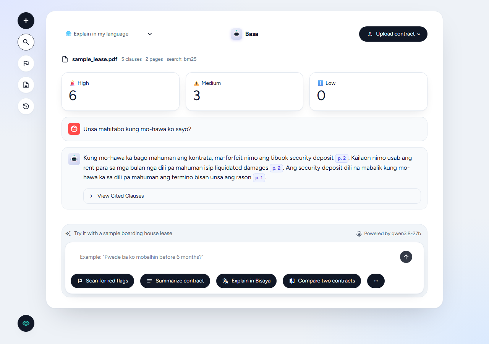
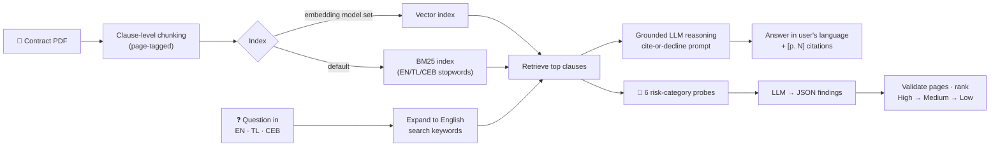

<div align="center">


# BASA (Kasunduan Guard)

### See what you're signing before you sign it — AI contract risk scanner and localized legal assistant for everyday Filipinos.

[](https://www.python.org/)
[](https://streamlit.io/)
[](https://pymupdf.readthedocs.io/)
[](#-how-it-works)
[](#-what-it-does)
[](#-how-it-works)



</div>

---

## 📌 Contents

- [Team](#-team)
- [What it does](#-what-it-does)
- [Slides](#-slides)
- [How it works](#-how-it-works)
- [How to run it](#-how-to-run-it)
- [Business plan](#-business-plan)

---

## 👥 Team

| Member | Role |
| --- | --- |
| **Adrian James Bona** | Full Stack & AI Systems Lead |
| **Johnloyd Encierto** | Backend & Retrieval Systems Engineer |
| **Iben Anoos** | Frontend & UI/UX Developer |
| **Johnru Bajenting** | Product Strategy & QA / Validation Engineer |

---

## 🎯 What it does

### The problem

Over **30 million Filipinos** sign leases (especially boarding house contracts), employment terms, and loan forms written in dense legal English. Renters and students routinely sign without reading, which leaves predatory clauses hidden on later pages: **total deposit forfeiture**, **₱500/day late fees with no cap**, eviction on a week's notice.

### The MVP solution

| Feature | What the user gets |
| --- | --- |
| 🚩 **Instant Red-Flag Scan** | Upload a PDF and get risks classified as **🚨 High / ⚠️ Medium / ℹ️ Low**, each with a plain-language explanation, the page, and the clause it came from |
| 💬 **Multilingual Grounded Q&A** | Ask in **English, Tagalog, or Bisaya**, e.g. *"Pwede ba ko mobalhin before 6 months?"*, and get the answer in your language |
| 📎 **Strict Document Grounding** | Built to a zero-hallucination standard: every answer cites the exact page/clause (`[p. 2]`) **or states that the contract doesn't mention it** |

<table>
<tr>
<td width="50%"></td>
<td width="50%"></td>
</tr>
<tr>
<td align="center"><sub>Red-flag scan of a Cebu boarding house lease</sub></td>
<td align="center"><sub>Bisaya Q&A with page-cited answers</sub></td>
</tr>
</table>

**Real output from the sample lease:**

```text
🧑 Pwede ba ko mobalhin before 6 months?                         (🌐 Explain in Bisaya)
🤖 Oo, pwede ka mobiya bago mahuman ang kontrata, pero naay daghang penalty.
   Kung mo-hawa ka bago matapos ang 12 ka bulan, ma-forfeit nimo ang tibuok
   security deposit ug bayranan nimo ang rent para sa mga bulan nga wala pa
   mahuman isip liquidated damages [p. 2].

🧑 Allowed ba ang pets sa property?
🤖 Hindi ito binanggit sa kontrata.          ← no pet clause exists, so BASA declines instead of inventing one
```

> [!IMPORTANT]
> BASA is a reading aid, **not legal advice**. Grounding and citations keep answers tied to the document, and every answer links back to its source clause so users can verify it themselves.

---

## 🖼 Slides

📊 **[Pitch Deck Slides](https://docs.google.com/presentation/...)**

---

## ⚙️ How it works

### Tech stack

| Layer | Technology |
| --- | --- |
| **Language** | Python 3.10+ (plain Python, with no LangChain or LlamaIndex) |
| **Frontend** | Streamlit with a custom light card UI |
| **PDF parsing** | PyMuPDF (`fitz` / `pymupdf`) |
| **Retrieval** | Vector index (NumPy cosine similarity) when an embedding model is configured; **BM25** (`rank_bm25`) keyword fallback otherwise |
| **LLM** | The hackathon's **OpenAI-compatible** model endpoint (`/chat/completions`), called through a ~90-line client (`llm.py`). The model is set in `.env`, so no code changes are needed to swap it |
| **Config / HTTP** | `python-dotenv`, `requests` |

### AI architecture & RAG pipeline



1. **Clause-level chunking** (`ingest.py`): PyMuPDF reads the PDF's own paragraph blocks, so numbered contract sections stay together instead of being cut at arbitrary token counts. Oversized clauses are split on sentence boundaries (≈800 characters, 80-character overlap), and a chunk **never crosses a page**, which keeps page citations exact.
2. **Indexing with metadata** (`retrieve.py`): every chunk carries its **page number** and **chunk ID**. If the endpoint provides embeddings, chunks are embedded and ranked by cosine similarity. Otherwise BM25 with an English/Tagalog/Bisaya stopword list is used.
3. **Cross-lingual retrieval:** contracts are usually in English, so Tagalog and Bisaya questions are first expanded into English search keywords before the top clauses are retrieved.
4. **Grounded reasoning:** retrieved clauses go to the LLM with a strict system prompt. It may use only those clauses, must cite `[p. N]` for every claim, and must say *"the contract does not mention this"* rather than guess.
5. **Risk heuristics** (`redflags.py`): six targeted probes (**Deposit & Refund, Penalties & Surcharges, Termination & Eviction, Auto-Renewal, Liability & Repairs, Rent & Price Escalation**) gather candidate clauses. One LLM call returns JSON findings, which are validated against the retrieved pages and sorted by severity.
6. **Localized generation:** the prompt pushes natural everyday phrasing ("ma-forfeit", "dili na mabalik", "hindi na maibabalik", "may multa") over stiff literal translation. A 🌐 selector can also force English, Tagalog, or Bisaya replies.

> [!NOTE]
> The red-flag scan runs **once per uploaded file** and is cached in the session. Contracts live only in memory: nothing is written to disk and there is no database.

---

## 🚀 How to run it

**Prerequisites:** Python 3.10+, plus an API key for an OpenAI-compatible LLM endpoint (the hackathon endpoint).

```bash
# 1. Clone
git clone https://github.com/x1ren/BASA.git
cd BASA/signsight

# 2. Create and activate a virtual environment
python -m venv .venv
.venv\Scripts\Activate.ps1          # Windows (PowerShell)
source .venv/bin/activate           # macOS / Linux

# 3. Install dependencies
pip install -r requirements.txt

# 4. Configure credentials
cp .env.example .env                # Windows: copy .env.example .env
```

Fill in `signsight/.env`:

```ini
HACKATHON_API_URL=https://your-endpoint.example/v1   # base URL, without /chat/completions
HACKATHON_API_KEY=replace-me                          # sent as "Authorization: Bearer ..."
HACKATHON_MODEL=replace-me                            # chat model ID
HACKATHON_EMBED_MODEL=                                # optional; leave blank to use BM25
```

> [!WARNING]
> `signsight/.env` is git-ignored. Never commit it, print it, or hardcode the key.

```bash
# 5. Check the connection, then start the app
python test_llm.py                  # expect: "Chat OK -> ..."
streamlit run app.py                # opens http://localhost:8501
```

> [!TIP]
> Open **<http://localhost:8501/?sample=1>** to load the bundled sample lease (a Brgy. Lahug, Cebu City boarding house contract) and run the red-flag scan automatically. `python test_app.py` runs a headless end-to-end test of the full UI against the live API.

---

## 💼 Business plan

### Problem & target users

| Segment | Who | Why they need BASA |
| --- | --- | --- |
| **Everyday signers** | Dormers, renters, freelancers, job seekers | Sign leases, job offers, and loans in legal English they can't fully parse, often under time pressure |
| **Small issuers** | Boarding house landlords, brokers, SMEs | Want fair, clear contracts and plain-language summaries for their signees, without hiring a lawyer for every template |

### Market size

| Metric | Estimate | Basis |
| --- | --- | --- |
| **National TAM** | **~₱500M** | National census data on renting households, combined with OFWs |
| **Central Visayas (beachhead)** | **~206,000 renting households** | Regional households at the national rental rate, starting with Cebu's student and tech dorm hubs |

### Unit economics & compute

- **Estimated compute cost: ~₱3–₱5 per contract scan**, based on small-model API pricing (Claude 3.5 Haiku–class) plus retrieval/indexing.
- One scan is a single structured LLM call over retrieved clauses rather than the whole document, so cost stays roughly flat as contracts get longer.

### Revenue model & monetization

| Tier | Price | For |
| --- | --- | --- |
| 🆓 **Free** | ₱0, 1 basic scan/month | First-time signers trying BASA |
| 🔍 **Pay-Per-Scan** | ₱99 per deep scan | One-off lease or job-offer checks |
| 👤 **Individual Pro** | ₱499/month | Active apartment hunters and freelancers: unlimited scans & Q&A |
| 🏠 **Business / Operator Pro** | ₱999/month | Landlords and brokers: pre-issue compliance checks and plain-language local summaries for signees |
| 🔌 **B2B API** | Custom | PropTech platforms and job portals embedding contract verification |

### Financial projections & breakeven

| | |
| --- | --- |
| **Funding ask** | **₱1.5M** seed/grant to cover Year 1 operations and development |
| **Breakeven** | **Year 3**: projected revenue **₱13.2M** vs. **₱11.5M** costs |
| **Year 3 milestones** | **8,000** paying individual subscribers · **500** active landlords/operators · **6** B2B platform integration clients |

### Competition

| | Generic LLMs<br/><sub>ChatGPT / Claude chat</sub> | Enterprise legal tech<br/><sub>Ironclad / Robin AI</sub> | **BASA** |
| --- | :---: | :---: | :---: |
| Answers tied to cited clauses | ❌ No clause-level bounding | ✅ | ✅ Page-cited, cite-or-decline |
| Local tenancy guardrails | ❌ | ❌ | ✅ Tuned for PH leases |
| Bisaya / Tagalog native | ⚠️ Inconsistent | ❌ | ✅ Dialect-native |
| Built for consumers & small landlords | ⚠️ General purpose | ❌ Enterprise procurement | ✅ |
| Price point | Subscription, not contract-specific | Enterprise contracts | **₱0–₱999/month** |

> [!TIP]
> **BASA's advantage:** dialect-native answers (Bisaya/Tagalog), clause-citation proof for every claim, and pricing that consumers and small landlords can actually afford.

### Next steps

- [ ] 📷 **Mobile camera OCR** for physical paper leases
- [ ] ⚖️ **Automated statutory compliance audit** against the Philippine **Rent Control Act** and **Labor Code**
- [ ] 🗣️ **Dialect expansion:** Ilocano and Hiligaynon

---

<div align="center">
<sub><b>BASA</b> means "read" in Filipino and Bisaya. Read before you sign. 🇵🇭</sub>
</div>
