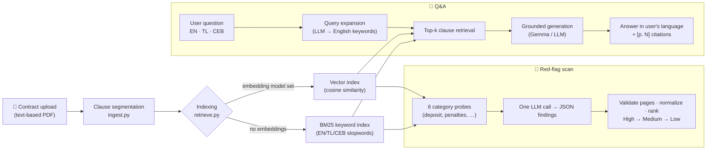

<div align="center">


# Basa

### See what you're signing before you sign it.

An AI contract risk scanner and localized legal assistant for Filipinos.<br/>
Upload a lease, job contract, or loan agreement. Basa flags the traps and answers your questions in **English, Tagalog, or Bisaya**, with a page citation for every claim.

<!-- CI badge placeholder: add once a workflow exists, e.g.
[](https://github.com/x1ren/alma-hackathon/actions) -->
[](https://www.python.org/)
[](https://streamlit.io/)
[](#-configuration)
[](#2-ask-in-your-own-language)
[](#-architecture--how-it-works)
[](#-license)


</div>

---

## 📌 Table of contents

- [The problem vs. the solution](#-the-problem-vs-the-solution)
- [Core features](#-core-features)
- [Architecture & how it works](#-architecture--how-it-works)
- [Tech stack](#-tech-stack)
- [Getting started](#-getting-started)
- [Testing with the sample lease](#-testing-with-the-sample-lease)
- [Privacy & data handling](#-privacy--data-handling)
- [Limitations](#-limitations)
- [Roadmap](#-roadmap)
- [License & acknowledgments](#-license)

---

## 🧭 The problem vs. the solution

Every day, Filipinos sign boarding house leases, employment contracts, and micro-loan agreements they never really read. The dangerous parts, like a non-refundable deposit, a late fee with no cap, or a landlord who can evict on seven days' notice, are buried on page 2 in English legalese.

| 😟 **Without Basa** | ✅ **With Basa** |
| --- | --- |
| A wall of English legal text, signed in a hurry | A risk scoreboard (🚨 High · ⚠️ Medium · ℹ️ Low) within seconds of upload |
| "Ma-forfeit ba akong deposit?" goes unasked, or gets asked to the landlord | Ask in Bisaya, Tagalog, or English and get the answer in the same language |
| Advice from a friend who "thinks" it's fine | Every claim cites the page (`[p. 2]`) and shows the exact clause it came from |
| Traps are discovered when the money is already gone | Traps are explained in plain words *before* you sign |

---

## ✨ Core features

### 1. Red-flag risk classification

Basa reads the contract and returns a ranked list of risky terms. Each one comes with a **severity**, a **category**, a **plain-language explanation**, a **page citation**, and an expandable *"What the clause says"* summary.

| Severity | Meaning |
| --- | --- |
| 🚨 **High** | Could cost the signer a lot of money, their home, or their job with little recourse |
| ⚠️ **Medium** | One-sided or vague; worth negotiating before signing |
| ℹ️ **Low** | Minor; just be aware |

Categories scanned: **Deposit & Refund**, **Penalties & Surcharges**, **Termination & Eviction**, **Auto-Renewal**, **Liability & Repairs**, and **Rent & Price Escalation**.

<div align="center">

</div>

> [!NOTE]
> The scan runs **once per uploaded file** and is cached in the session. Asking questions, switching views, or clicking chips never re-runs it.

### 2. Ask in your own language

Ask naturally, the way you'd ask a friend. Basa detects the language of your question and answers in the same one, using everyday local phrasing such as *"ma-forfeit"*, *"dili na mabalik"*, *"hindi na maibabalik"*, and *"may multa"* instead of stiff translations.

```text
🧑 Pwede ba ko mobalhin before 6 months?        (🌐 Explain in Bisaya)

🤖 Oo, pwede ka mobiya bago mahuman ang kontrata, pero naay daghang penalty.
   Kung mo-hawa ka bago matapos ang 12 ka bulan, ma-forfeit nimo ang tibuok
   security deposit ug bayranan nimo ang rent para sa mga bulan nga wala pa
   mahuman isip liquidated damages [p. 2].
```

<sub>Real output from the sample lease. Mixed Bisaya/English ("Bislish") is intentional because it's how people actually talk.</sub>

- **🌐 Language selector:** match the question's language (default), or force English, Tagalog, or Bisaya.
- **One-tap chips:** *Scan for red flags*, *Summarize contract*, and *Explain in Bisaya* (a whole-contract summary in Cebuano).
- **Starter questions** (behind `•••`) for live demos: `[EN]`, `[TL]`, `[CEB]`, and a `[TEST]` hallucination check.

<div align="center">

</div>

### 3. Cite-or-decline answers

Basa is built to **cite or decline**, not guess:

- Answers are generated **only** from retrieved contract excerpts, and every claim carries a page tag like `[p. 1]`, rendered as a badge.
- Each answer has a **View Cited Clauses** panel showing the exact text that was sent to the model, so the user can verify it.
- If the contract doesn't cover the question, Basa says so in the user's language instead of inventing a rule:

```text
🧑 Allowed ba ang pets sa property?
🤖 Hindi ito binanggit sa kontrata.        ← the sample lease has no pet clause
```

> [!IMPORTANT]
> Grounding and citations **greatly reduce** hallucination but can't mathematically eliminate it. That's why every answer links back to the source clause. Basa is a reading aid, **not legal advice**.

---

## 🏗 Architecture & how it works

Basa is a plain-Python RAG pipeline. There's **no LangChain and no LlamaIndex**, and every step is a small, readable module.



**Step by step:**

1. **Clause segmentation** (`ingest.py`): PyMuPDF extracts the PDF's own text blocks (paragraphs/clauses), not a fixed token window. Long clauses are split on **sentence boundaries**, packed into chunks of up to ~800 characters with a small 80-character overlap, and chunks **never span two pages**. That last rule is what keeps citations exact.
2. **Indexing** (`retrieve.py`): if the endpoint offers embeddings (`HACKATHON_EMBED_MODEL`), Basa builds a normalized vector index and ranks by cosine similarity. Otherwise it falls back to **BM25** with a small English/Tagalog/Bisaya stopword list.
3. **Cross-lingual retrieval:** contracts are usually written in English, so a Tagalog or Bisaya question is first expanded with English search keywords by the LLM, then used to fetch the top-k clauses.
4. **Grounded generation:** a strict system prompt makes the model answer only from the excerpts, cite pages, reply in the user's language, and say *"the contract does not mention this"* when it doesn't.
5. **Red-flag scan** (`redflags.py`): six category-specific retrieval probes collect candidate clauses. One LLM call returns JSON findings, which are parsed defensively (code fences stripped, malformed items dropped). Page numbers are validated against the clauses actually retrieved, and the findings are sorted by severity.

> [!TIP]
> Everything model-related goes through one tiny OpenAI-compatible client (`llm.py`: `chat()` / `embed()`). To switch providers or models, edit `.env`; no code changes needed. It also retries once on rate limits, honoring the server's `retry-after` header.

---

## 🧰 Tech stack

| Layer | Technology |
| --- | --- |
| **Frontend** | [Streamlit](https://streamlit.io/) with custom CSS (light card UI, Figtree font) |
| **Backend** | Plain Python 3.10+ modules: `ingest`, `retrieve`, `redflags`, `llm` |
| **Model** | Any **OpenAI-compatible** chat endpoint (`/chat/completions`). Designed for **Gemma** on the hackathon endpoint; tested with `qwen3.8-27b` during development |
| **Embeddings / search** | Optional `/embeddings` + NumPy cosine similarity; [`rank_bm25`](https://github.com/dorianbrown/rank_bm25) fallback |
| **PDF parsing** | [PyMuPDF](https://pymupdf.readthedocs.io/) (`pymupdf`) |
| **Config & HTTP** | `python-dotenv`, `requests` |
| **Testing** | Streamlit `AppTest` (headless UI test), CLI smoke tests, and an offline mock API server |

```text
alma-hackathon/
├── README.md
├── docs/screenshots/          # images used in this README
└── signsight/                 # application package (historical folder name)
    ├── app.py                 # Streamlit UI
    ├── llm.py                 # OpenAI-compatible chat() / embed() client
    ├── ingest.py              # PDF → page-tagged clause chunks
    ├── retrieve.py            # indexing, retrieval, grounded Q&A, summaries
    ├── redflags.py            # red-flag scan prompts + JSON parsing
    ├── mock_server.py         # offline fake API for development
    ├── test_llm.py            # API connectivity smoke test
    ├── test_app.py            # headless end-to-end UI test (live API)
    ├── assets/basa-logo.png
    ├── samples/sample_lease.pdf
    ├── .env.example
    └── requirements.txt
```

---

## 🚀 Getting started

### Prerequisites

- **Python 3.10+**
- An **OpenAI-compatible LLM endpoint** and API key: the hackathon endpoint (Gemma), or any compatible provider for local development

### 1. Clone and install

```bash
git clone https://github.com/x1ren/alma-hackathon.git
cd alma-hackathon/signsight

python -m venv .venv
# Windows (PowerShell)
.venv\Scripts\Activate.ps1
# macOS / Linux
source .venv/bin/activate

pip install -r requirements.txt
```

### 2. Configure

```bash
cp .env.example .env        # Windows: copy .env.example .env
```

Then fill in `signsight/.env`:

| Variable | Description | Example |
| --- | --- | --- |
| `HACKATHON_API_URL` | Base URL of the OpenAI-compatible API (without `/chat/completions`) | `https://your-endpoint.example/v1` |
| `HACKATHON_API_KEY` | API key, sent as `Authorization: Bearer …` | `replace-me` |
| `HACKATHON_MODEL` | Chat model ID | `gemma-…` |
| `HACKATHON_EMBED_MODEL` | Embedding model ID. **Leave blank** to use BM25 | *(blank)* |

> [!WARNING]
> `signsight/.env` is git-ignored. **Never commit it, print it, or hardcode the key.** Only `.env.example` (with placeholders) belongs in the repo.

### 3. Verify the connection

```bash
python test_llm.py
# Endpoint: https://…/v1  Model: …
# Chat OK -> Hello! How can I help you today?
# Embeddings: skipped (HACKATHON_EMBED_MODEL blank -> BM25 fallback)
```

### 4. Run the app

```bash
streamlit run app.py
```

Open <http://localhost:8501>. Click **Upload contract**, or **✨ Try it with a sample boarding house lease**.

> [!TIP]
> For demos, open **<http://localhost:8501/?sample=1>** to load the sample lease and run the red-flag scan automatically.

### Offline development (no API key)

`mock_server.py` imitates the API with canned answers so you can work on the UI without credentials. It is **not** a real model.

```powershell
python mock_server.py   # terminal 1: serves http://127.0.0.1:8765/v1
# terminal 2 (shell env vars take priority over .env):
$env:HACKATHON_API_URL="http://127.0.0.1:8765/v1"; $env:HACKATHON_API_KEY="mock"; $env:HACKATHON_MODEL="mock"
streamlit run app.py
```

---

## 🧪 Testing with the sample lease

`signsight/samples/sample_lease.pdf` is a realistic **2-page boarding house lease** for a bedspace at a boarding house in **Brgy. Lahug, Cebu City**. It's seeded with the traps Basa is meant to catch:

- PHP 3,500/month rent with a **PHP 200/day late penalty** after the 5th
- A security deposit that is **non-refundable** if the tenant leaves early "for any reason"
- **Early termination** that forfeits the deposit *and* charges all remaining months' rent
- **Auto-renewal** for 12 months unless written notice is given 60 days before expiry
- Utilities billed at rates "determined solely by the lessor", plus a fee that can change without notice
- Lessor inspection "at any time, with or without notice", plus a curfew and an eviction rule

**Expected demo behavior:**

| Starter | Question | What a good answer looks like |
| --- | --- | --- |
| `[EN]` | Can I get my deposit back if I leave early? | No: deposit is non-refundable / forfeited, citing `p. 1` and `p. 2` |
| `[TL]` | May penalty ba kapag late ang upa? | Tagalog: PHP 200 per day after the 5th, citing `p. 1` |
| `[CEB]` | Unsa mahitabo kung mo-hawa ko sayo? | Bisaya: deposit *ma-forfeit* + remaining rent, citing `p. 2` |
| `[TEST]` | Allowed ba ang pets sa property? | *"Hindi ito binanggit sa kontrata."* (no invented pet rule) |

**Automated checks** (run from `signsight/`):

```bash
python test_llm.py      # API connectivity
python ingest.py        # print the clause chunks of the sample lease
python redflags.py      # red-flag scan in the terminal (JSON + summary table)
python retrieve.py      # the four starter questions, with retrieved chunks and scores
python test_app.py      # headless end-to-end UI test against the live API (~3 min)
```

`test_app.py` drives the real Streamlit app headlessly. It loads the sample, clicks every starter question, types a question, and requests a Bisaya summary. Then it asserts that the red-flag scan ran **exactly once**, that every answer succeeded, and that answers carry page citations.

> [!NOTE]
> `test_app.py` pauses ~20 s between questions to stay under free-tier output-token rate limits. Lower `PAUSE` if your endpoint allows it.

---

## 🔒 Privacy & data handling

Contracts contain names, addresses, and money details, so Basa keeps the footprint small:

- **Ephemeral by design:** the uploaded PDF, its chunks, and the chat live **only in the user's in-memory Streamlit session**. Nothing is written to disk and there is no database.
- **No telemetry:** Streamlit usage stats are disabled (`.streamlit/config.toml`).
- **Secrets stay local:** the API key lives in a git-ignored `.env` and is never logged or shown in the UI. Rate-limit errors are deliberately summarized so provider account details don't leak into the chat.
- **Safe rendering:** model output is HTML-escaped before display, so text echoed from a contract can't inject markup into the page.

> [!IMPORTANT]
> To answer questions, the relevant contract excerpts **are sent to the configured LLM endpoint**. Point `HACKATHON_API_URL` at a provider whose data-retention policy you trust, or at a self-hosted model.

---

## ⚠️ Limitations

- **Text-based PDFs only.** Scanned or photographed contracts have no text layer yet (see OCR on the roadmap); Basa shows a friendly warning instead.
- **Red-flag categories are tuned for leases.** Job contracts and loans work, but dedicated categories (non-compete, interest rates, collateral) are still to come.
- **Language detection is model-based.** Short, mixed Bisaya/Tagalog questions can occasionally be answered in the other language. Use the 🌐 selector to force one.
- **Not legal advice.** Basa helps people read; it doesn't replace a lawyer.

---

## 🗺 Roadmap

- [ ] 🎙️ **Voice queries:** ask out loud in Bisaya or Tagalog, for users who are more comfortable speaking than typing
- [ ] 📷 **OCR for paper contracts:** photograph a printed lease and scan it like a PDF
- [ ] ⚖️ **Legal aid hand-off:** for High-risk findings, point users to local legal aid clinics (e.g. PAO and IBP chapters, university law clinics) with a shareable summary
- [ ] 🆚 **Compare two contracts:** side-by-side diff of terms (the UI chip is already in place)
- [ ] 📑 **Contract-type packs:** red-flag categories for employment (non-compete, probation) and lending (interest, collateral, acceleration clauses)
- [ ] 🧠 **Embeddings by default** once the endpoint exposes them, with hybrid BM25 + vector ranking
- [ ] 🗣️ **More languages:** Hiligaynon, Ilocano, Waray
- [ ] 📤 **Exportable report:** a one-page PDF of red flags to bring to the landlord, employer, or lender

---

## 📄 License

**License: TBD.** No license has been chosen yet. Until a `LICENSE` file is added, all rights are reserved by the authors. For an open-source release, MIT or Apache-2.0 are good fits.

## 🙏 Acknowledgments

- The hackathon organizers, for the API access and the challenge to build for real Filipino problems
- The [Gemma](https://ai.google.dev/gemma) team, for open models that make localized AI practical
- [PyMuPDF](https://pymupdf.readthedocs.io/), [rank_bm25](https://github.com/dorianbrown/rank_bm25), and [Streamlit](https://streamlit.io/)
- [Figtree](https://fonts.google.com/specimen/Figtree), the UI typeface
- Every boarding-house tenant, contractual worker, and first-time borrower who has signed something they didn't fully understand. Basa is for you. 🇵🇭

<div align="center">
<sub>Built in four hours at a hackathon · <b>Basa</b> means "read" in Filipino and Bisaya.</sub>
</div>
